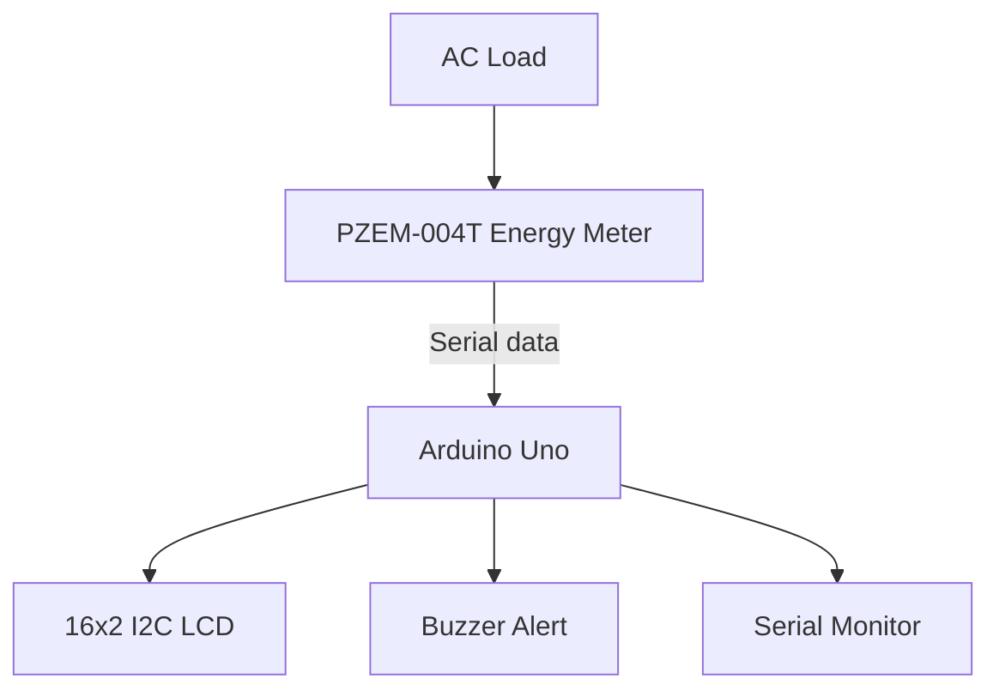

# ⚡ Smart Electricity Saver

> **ECE – 2nd Year Mini Project**  
> An Arduino Uno based electricity monitoring system that measures voltage, current, power and energy consumption, estimates the electricity cost, and alerts the user when consumption crosses a configurable limit.


## 📌 Project Overview

The **Smart Electricity Saver** monitors the electrical energy used by a connected load. A PZEM-004T energy-meter module measures electrical parameters and sends the readings to an Arduino Uno. The Arduino displays the readings on a 16×2 I2C LCD, estimates the energy cost, and sounds a buzzer if the measured power exceeds a preset limit.

This is a **monitoring and alert prototype**. It does not automatically reduce consumption or disconnect the load in this version. Users can act on the readings to avoid unnecessary usage.

## ✨ Features

- Real-time voltage (V), current (A), and active power (W) monitoring
- Cumulative energy reading (kWh)
- Approximate electricity-cost calculation
- LCD display with rotating information pages
- Buzzer alert when power exceeds a configurable threshold
- Serial Monitor output for testing and debugging

## 🧰 Hardware Requirements

| Component | Quantity | Purpose |
|---|---:|---|
| Arduino Uno | 1 | Main controller |
| PZEM-004T energy meter (with compatible CT and interface) | 1 | Measures AC electrical parameters |
| 16×2 LCD with I2C backpack | 1 | Displays readings |
| Active buzzer module | 1 | High-power alert |
| Jumper wires | As required | Low-voltage connections |
| USB cable / suitable regulated supply | 1 | Arduino power |
| Enclosure and insulated terminals | As required | Safe assembly |

**Important:** Confirm the exact PZEM-004T version and wiring diagram supplied with your module. Do not connect mains voltage to Arduino pins or a breadboard.

## 🔌 System Block Diagram



## 🔗 Low-Voltage Connections

| Module | Module pin | Arduino Uno |
|---|---|---|
| PZEM TTL interface | TX | D10 (SoftwareSerial RX) |
| PZEM TTL interface | RX | D11 (SoftwareSerial TX) |
| PZEM TTL interface | GND | GND, if required by the module version |
| I2C LCD | SDA | A4 |
| I2C LCD | SCL | A5 |
| I2C LCD | VCC | Supply voltage specified by LCD backpack |
| I2C LCD | GND | GND |
| Buzzer module | Signal / IN | D7 |
| Buzzer module | GND | GND |
| Buzzer module | VCC | Rated supply |

The PZEM's AC input and current-transformer (CT) installation are **not** shown as Arduino wiring. Follow the exact manufacturer's diagram for your model. Have all mains-side wiring installed and checked by a qualified person.

## 💻 Software Setup

1. Install the [Arduino IDE](https://www.arduino.cc/en/software).
2. Install these libraries using **Sketch → Include Library → Manage Libraries** (or the library manager in your IDE):
   - `PZEM-004T-v30` / `PZEM004Tv30` library compatible with your module
   - `LiquidCrystal_I2C`
3. Open `code/smart_electricity_saver.ino`.
4. Confirm the LCD I2C address (commonly `0x27` or `0x3F`) and module version.
5. Select **Arduino Uno** and the correct port, then upload.
6. Open Serial Monitor at **9600 baud**.

## ⚙️ Configuration

Edit the constants near the top of the sketch:

```cpp
const float COST_PER_KWH = 7.00;       // Example tariff only; change to your tariff
const float POWER_LIMIT_WATTS = 500.0; // Buzzer threshold
```

The tariff is only an example. Actual electricity tariffs vary by location, provider, slab and taxes. The displayed cost is an estimate based on the configured rate.

## 📟 Example Display

- Page 1: Voltage and current
- Page 2: Active power and energy
- Page 3: Estimated cost and power-alert status

Values shown depend on the connected load and meter.

## 🧪 Testing Procedure

1. First test the Arduino, LCD and buzzer using only their low-voltage supply.
2. Verify that the LCD displays a startup message.
3. Verify serial communication with the exact PZEM model.
4. Ask a qualified person to inspect the enclosed mains-side meter/load wiring before energizing it.
5. Compare readings with a trusted meter where available.
6. Test the alert threshold using a safe, supervised test load; do not deliberately overload wiring or equipment.

## 📁 Repository Structure

```text
SMART-ELECTRICITY-SAVER/
├── README.md
├── LICENSE
├── .gitignore
├── code/
│   └── smart_electricity_saver.ino
├── documentation/
│   ├── project-report.md
│   └── working-principle.md
├── circuit-diagram/
│   └── connections.md
└── components/
    └── components-list.md
```

## 🚧 Limitations and Future Scope

- Readings depend on the PZEM model, correct installation and calibration.
- Cost calculation uses one user-entered rate and does not model billing slabs, fixed charges or taxes.
- This version alerts the user but does not switch the load.
- Future improvements: ESP32/Wi-Fi dashboard, data logging, monthly usage graphs, multi-load monitoring and a properly rated certified disconnect device designed by a qualified professional.

## ⚠️ Electrical Safety

This project may interface with hazardous AC mains. **Never handle exposed mains wiring while powered.** Use a properly rated, enclosed energy-meter module, correctly rated fuse/protection and insulated terminals. Mains wiring and testing must be performed by a qualified person. Keep the Arduino, LCD and other low-voltage electronics isolated from mains conductors. Do not use a breadboard for mains wiring.

## 📚 References

- [Arduino Uno documentation](https://docs.arduino.cc/hardware/uno-rev3/)
- [Arduino IDE](https://www.arduino.cc/en/software)
- PZEM-004T datasheet and wiring instructions supplied by the module manufacturer/vendor.

## 👨‍🎓 Project Details

**Project:** Smart Electricity Saver  
**Department:** Electronics and Communication Engineering (ECE)  
**Academic Level:** 2nd Year Mini Project  
**Controller:** Arduino Uno

> Replace this section with your name, roll number, college name, guide name, actual hardware photographs and test results before submitting.
