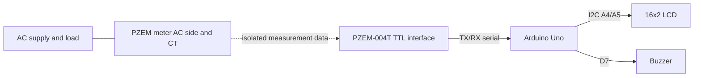

# Circuit Connections

## Arduino-side (isolated low-voltage side)

| Device | Pin | Arduino Uno |
|---|---|---|
| PZEM TTL interface | TX | D10 (SoftwareSerial RX) |
| PZEM TTL interface | RX | D11 (SoftwareSerial TX) |
| PZEM TTL interface | GND | GND, if required by your interface version |
| I2C LCD | SDA | A4 |
| I2C LCD | SCL | A5 |
| I2C LCD | VCC | As specified by LCD module |
| I2C LCD | GND | GND |
| Active buzzer module | IN / Signal | D7 |
| Active buzzer module | VCC | Rated supply |
| Active buzzer module | GND | GND |

## Functional connection diagram

## Important wiring notes

- The table covers only low-voltage signal connections.
- The PZEM AC input, CT and any voltage-sensing terminals must be wired exactly as specified for the precise PZEM model/revision.
- Some PZEM versions have different TTL interface arrangements. Confirm the module manual before connecting.
- Never connect AC mains to Arduino GPIO, USB, breadboard rails or the LCD.
- Use an enclosed, appropriately rated assembly with protective devices. Mains wiring and testing must be performed by a qualified person.
- If the LCD is blank, verify its I2C address (`0x27` is common; `0x3F` is another common address).
